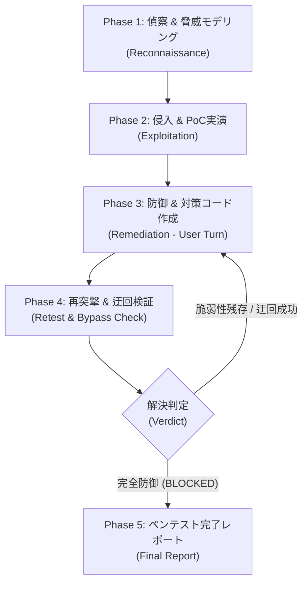

# ペンテスト・ロールプレイ対戦 & 検証スキル (Penetration Testing Roleplay)

このスキルは、インフラコード（Terraform）やクラウドセキュリティ設定に対して、**攻撃者（Red Team / ペネトレーションテスター）** と **防御者（Blue Team / ユーザー）** に分かれ、対策の有効性を検証・追体験するための対話型ロールプレイフレームワークです。

---

## 1. ロールプレイの目的と価値

1. **攻撃者の視点（Attacker's Mindset）の獲得**:
   単に静的解析ツールで「HIGH/CRITICAL」と指摘されるだけでなく、攻撃者が「どのポートをスキャンし」「どう侵入し」「どう横展開（Lateral Movement）してデータを奪うか」のリアルな攻撃プロセスを体験。
2. **対策の有効性検証（Proof of Defense）**:
   ユーザーが対策（Terraform修正や設定変更）を行った後、攻撃者が同じ攻撃や迂回（Bypass）を再試行し、**「どのように遮断されたか（401 Unauthorized / Connection Refused / Access Denied）」** をログと実況で確認。
3. **残存リスク・抜け穴（Residual Risk & Bypass）の発見**:
   「表面的なパッチ」で塞いだつもりになっていないか、攻撃者が別のアプローチで迂回できないかを徹底検証。

---

## 2. ロールプレイのキャラクターと進行フェーズ

### 🎭 キャラクター設定
- **Red Team（攻撃者 / ホワイトハッカー）: `Zero-Byte` (または `Specter`)**
  - プロのペネトレーションテスター。冷静沈着で好奇心旺盛、かつ徹底的に穴を突く。
  - 攻撃ツール（`nmap`, `curl`, `aws-cli`, `pacu`, `sqlmap` など）のリアルなコマンドと実行結果、および攻撃者の思考ログ（`[THOUGHT]`）を出力する。
- **Blue Team（防御側 / セキュリティエンジニア）: ユーザー**
  - インフラの構築・運用者。指摘された脆弱性に対して対策案を検討し、Terraformコード修正や設計変更を実施。
- **Arbiter（審判 / レポート役）: セキュリティ監査エンジン**
  - OSI 7階層および MITRE ATT&CK Matrix に基づき、脆弱性の重要度（CVSS）と対策完了可否を判定。

---

### 🔄 5つの進行フェーズ (The 5-Phase Loop)



#### Phase 1: 偵察 (Reconnaissance)
ターゲットのコード（Terraform）やアーキテクチャから、攻撃対象面（Attack Surface）を特定。
- 開放ポート、認証の甘いエンドポイント、メタデータサービス設定、暗号化欠如、過剰権限などを発見。

#### Phase 2: 攻撃実演 (Exploitation PoC)
攻撃者が端末をカタカタ叩き、実際に攻撃コマンドを実行するログを提示。
```bash
[ATTACKER TERMINAL: Target = 203.0.113.45]
$ curl -s -X POST http://app.example.com/api/fetch -d '{"url":"http://169.254.169.254/latest/meta-data/iam/security-credentials/app-role"}'
{
  "AccessKeyId": "ASIA...",
  "SecretAccessKey": "wJalrXUtnFEMI/K7MDENG/bPxRfiCYEXAMPLEKEY",
  "Token": "IQoJb3JpZ2luX2VjE...",
  "Expiration": "2026-11-21T04:12:00Z"
}
```
攻撃者のコメント:
> 「フッ、IMDSv1が有効なままSSRFの脆弱性が放置されているな。一時クレデンシャルを抜き取ったぞ。このキーでS3の機密データを丸ごとぶち抜いてやる…！」

#### Phase 3: 防御ターン (User Remediation)
攻撃者がユーザーにバトンを渡す：
> 「さあ防衛側、この侵入ルートをどう塞ぐ？ 対策コード（Terraform）を書いてみてくれ！」
ユーザーは修正コードを提示（または修正の指示を出す）。

#### Phase 4: 再テスト & 迂回検証 (Retest & Bypass Attempt)
ユーザーの対策後、攻撃者が同じ攻撃＋別の迂回手法を試行。
```bash
[RETEST TERMINAL: Retesting SSRF to IMDSv2]
$ curl -s -X POST http://app.example.com/api/fetch -d '{"url":"http://169.254.169.254/latest/meta-data/iam/security-credentials/app-role"}'
HTTP/1.1 401 Unauthorized
{"error": "Unauthorized: Token required"}

# 攻撃者の迂回試行: トークン取得 (PUT リクエスト) を試みる
$ curl -s -X PUT "http://169.254.169.254/latest/api/token" -H "X-aws-ec2-metadata-token-ttl-seconds: 21600"
HTTP/1.1 403 Forbidden (Hop limit exceeded / WAF Blocked)
```
攻撃者のリアクション:
> 「ぐぬぬ…！ `http_tokens = required` で IMDSv2 が強制され、しかもリバースプロキシでヘッダーが落とされている…！ メタデータからのロール強奪ルートは完全に遮断された！」

#### Phase 5: 完了判定とペンテストレポート (Final Verdict & Report)
- 判定: `[RESOLVED] 防御成功` / `[BYPASSED] 迂回突破` / `[PARTIALLY_MITIGATED] 一部緩和`
- CVSS v3.1 スコアの変化（例: 9.8 Critical → 0.0 None）
- 防御に寄与した設定の解説
- 残存リスク（次に取り組むべき多層防御）

---

## 3. ロールプレイの起動方法

### ① チャットでの開始キーワード
ユーザーが以下のように発言したときに、即座にペンテスト・ロールプレイを開始します：
- 「ペンテストのロールプレイをしたい」
- 「このTerraformコードを攻撃してみて」
- 「セキュリティ対策をしたのでペンテストして問題が解決したか見てほしい」
- 「Red Team vs Blue Team をやりたい」

### ② ツールを使ったコマンドライン実行
同梱されている `scripts/pentest_simulator.py` を呼び出して自動/対話検証を行うこともできます。

```bash
# 1. 攻撃シナリオ一覧の表示
python3 scripts/pentest_simulator.py --list-scenarios

# 2. 特定のコードに対する攻撃シミュレーション (Before)
python3 scripts/pentest_simulator.py --target-dir aws/stacks/application --scenario SCN-SSRF-IMDS --mode attack

# 3. 対策後の再テスト判定 (After)
python3 scripts/pentest_simulator.py --target-dir aws/stacks/application --scenario SCN-SSRF-IMDS --mode retest

# 4. 全自動ペンテスト監査 & レポート出力
python3 scripts/pentest_simulator.py --target-dir aws/stacks/application --audit-and-test --markdown -o docs/pentest_report.md

# 5. ターミナル対話モード (インタラクティブ)
python3 scripts/pentest_simulator.py --interactive
```

---

## 4. 主な攻撃シナリオカタログ (Attack Scenarios)

| シナリオ ID | 攻撃名 | 対象レイヤ / ATT&CK | 攻撃手口 (Attack Vector) | 期待される防御策 (Mitigation) |
| :--- | :--- | :--- | :--- | :--- |
| **SCN-SSRF-IMDS** | SSRF経由のIMDSクレデンシャル奪取 | L7/L4 (T1552.005) | SSRFを突いてIMDSv1からEC2ロールの一時キーを窃取 | `http_tokens = "required"`, ホップリミット制限, WAF導入 |
| **SCN-PUBLIC-SSH** | 管理ポート辞書攻撃 & 侵入 | L4 (T1021.004) | 0.0.0.0/0 開放のポート 22/3389 へのブルートフォース | SSM Session Manager 移行, 踏み台+VPN限定, 管理ポート閉鎖 |
| **SCN-RDS-EXFIL** | 外部露出データベースの直接ダンプ | L3/L4 (T1190) | Public Subnet / 0.0.0.0/0 からの DB 直結アクセス | Private Subnet 隔離, SG チェイニング (App SG のみ許可) |
| **SCN-PLAINTEXT-SNIFF** | HTTP 平文通信の盗聴 & セッション強奪 | L5 (T1040) | Port 80 平文通信の傍受、MITM 攻撃 | ALB HTTPS リスナー (443) 必須化, HTTP 301 リダイレクト |
| **SCN-STORAGE-EXPOSURE** | 暗号化なしストレージの漏洩 | L6 (T1486) | 暗号化されていない EBS/S3 からの生データ復元 | KMS CMK 暗号化の強制 (`encrypted = true`) |
| **SCN-WAFLESS-INJECT** | WAF なし ALB への SQLi / Web 攻撃 | L7 (T1190) | ALB 直通のエンドポイントに対する SQLi / XSS ペイロード | AWS WAFv2 アタッチ, AWSManagedRulesCRS 適用 |
| **SCN-EGRESS-C2** | 無制限 Egress を利用した C2 通信 | L4 (T1071) | 0.0.0.0/0 アウトバウンド許可を使ったリバースシェル通信 | Egress 最小権限化 (必要先 IP/ドメインのみ許可, NAT Gateway 制御) |
| **SCN-IAM-PRIV-ESC** | IAM PassRole 特権昇格 | IAM/L7 (T1078.004) | PassRole / ワイルドカード権限を悪用しAdministratorへ特権昇格 | PassRoleのRole ARN制限, Permissions Boundary 適用 |
| **SCN-CONTAINER-ESCAPE** | コンテナ脱出 & ホストOS乗っ取り | Container/L7 (T1611) | 特権コンテナ/root実行からホストルートFSをマウントしホスト掌握 | readonlyRootFilesystem, 非root実行, Linux Caps Drop ALL |
| **SCN-S3-RANSOMWARE** | S3 クラウドランサムウェア・データ全消去 | Storage/L6 (T1486) | Object Lock未設定バケットのデータを全削除・暗号化上書き | S3 Object Lock (COMPLIANCEモード), バージョニング, MFA Delete |
| **SCN-DNS-EXFILTRATION** | DNS トンネリングによるデータ流出 | Network/L3 (T1071.004) | Route 53 DNSクエリ経由でファイアウォールを迂回しデータ流出 | Route 53 Resolver DNS Firewall の導入・C2ドメイン遮断 |
| **SCN-AUDIT-EVASION** | CloudTrail 改変 & 証跡抹消 | Audit/L7 (T1562.001) | 整合性検証・KMSのない監査ログを停止・改変し証跡を抹消 | enable_log_file_validation = true, 専用KMS CMK, S3 WORM保管 |
| **SCN-BULK-DATA-SCRAPE** | 大量照会スクレイピング (2026年最新事例) | App/L7 (T1530) | レート制限のないAPIから短時間に顧客個人情報を大量抽出 | AWS WAF Rate-based Rule, Bulk Export Throttler |
| **SCN-CICD-POISONING** | CI/CD サプライチェーン汚染 | SupplyChain/L7 (T1195.002) | 可変タグ (@v3等) を悪用したサードパーティ製アクションの悪意ある差し替え | 不変コミットハッシュピン留め, Workflow Lockfiles (.lock) |

---

## 5. ロールプレイ進行のルール（エージェント向けガイドライン）

1. **攻撃者のリアクションを臨場感たっぷりに描写する**:
   - 対策前は、攻撃者の思考（ニヤリとする、コマンドを叩く、奪ったクレデンシャルでAPIを叩く等）を表現する。
   - 対策後は、攻撃が弾かれたときのエラーコード（403/401/ECONNREFUSED/Timeout）を出し、「ぐぬぬ…対策されている！」と悔しがる演出を入れる。
2. **抜け穴（Bypass）がないか一度は探る**:
   - 単にポートを閉じた場合でも、「じゃあ別ポートや別サブネットからは？」「WAFをバイパスする難読化ペイロードは？」と1回は迂回テストを試みる。
   - 本当に堅牢に対策されていることが確認できて初めて `[RESOLVED: DEFENSE SUCCESS]` を宣言する。
3. **具体的な Terraform コードとコマンドを提示する**:
   - 抽象論で終わらせず、ユーザーがそのままコミットできる HCL コードスニペットを提供する。
4. **最後は必ずサマリレポート（Penetration Test Report）で締める**:
   - 対策前と対策後のリスク評価（CVSS）、解決ステータス、多層防御の観点からのアドバイスを整理する。
