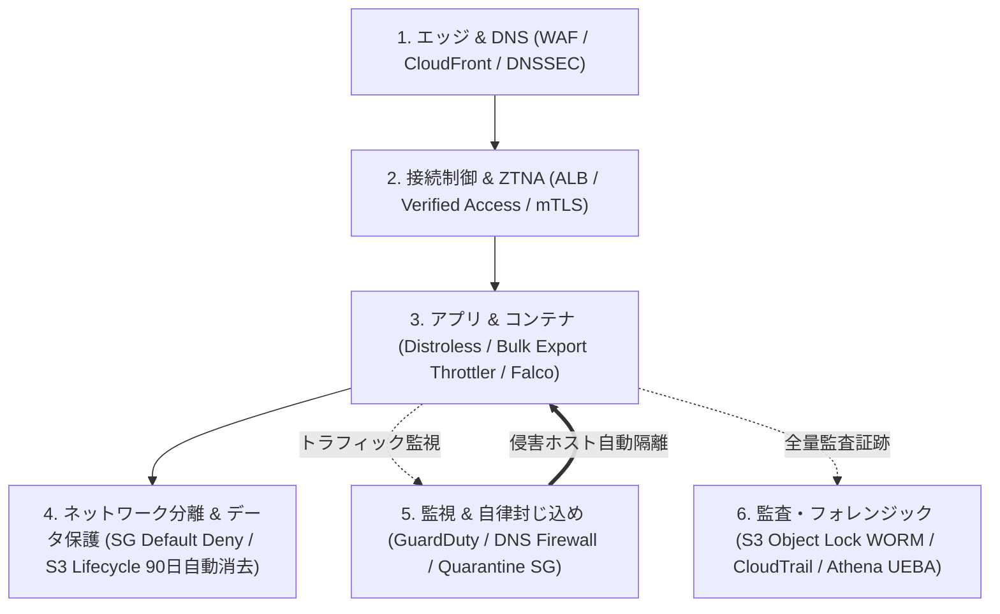

# Terraform Infrastructure

This repository contains Terraform code for managing infrastructure on AWS and GCP.

## Project Structure

The repository is organized by cloud provider, with each provider having its own directory:

- **aws/**: Contains Terraform code for AWS resources.
- **gcp/**: Contains Terraform code for GCP resources.

Within each provider directory, the code is further divided into:

- **modules/**: Reusable Terraform modules for creating specific resources (e.g., an S3 bucket, a GCS bucket).
- **services/**: Configurations that use the modules to deploy services.

## Testing

This project uses the built-in Terraform testing framework. Tests are located in the `tests/` directory, and the structure of the `tests/` directory mirrors the structure of the main provider directories.

To run the tests, navigate to the specific test directory (e.g., `tests/aws/s3`) and run the following command:

```
terraform test
```

## Security Scan & Governance

To ensure infrastructure security and compliance with organizational policies:

```bash
# Trivy & OPA Policy Scan
./scripts/security_check.sh

# OSI 7-Layer Security Audit & Auto-Remediation
python3 scripts/osi_security_audit.py --target-dir aws/stacks/application

# Pre-Apply Security Gate
./scripts/pre_apply_gate.sh
```

## 🎯 Penetration Testing Roleplay & Defense Verification (Red vs Blue)

セキュリティ対策を実施した際に、攻撃者視点で侵入PoCを実行し、対策コード適用後に再テスト（Retest / Bypass検証）を行って問題が真に解決したかを追体験・検証できるロールプレイ環境です。

- **AI 対話ロールプレイ**: チャットで「ペンテストのロールプレイをして」「このコードを攻撃してみて」と発言すると、Red Team ペンテスター（`Zero-Byte`）との攻防戦が開始されます。
- **CLI シミュレータ**: `scripts/pentest_simulator.py`
  - 攻撃シナリオ一覧表示: `python3 scripts/pentest_simulator.py --list-scenarios`
  - 侵入PoC実演 (Before): `python3 scripts/pentest_simulator.py -t aws/stacks/application -s SCN-SSRF-IMDS -m attack`
  - 対策後再テスト (After): `python3 scripts/pentest_simulator.py -t aws/stacks/application -s SCN-SSRF-IMDS -m retest`
  - 全自動監査＆レポート: `python3 scripts/pentest_simulator.py -t aws/stacks/application -a --markdown -o docs/pentest_report.md`
- **詳細ガイド**: [docs/pentest_roleplay_guide.md](docs/pentest_roleplay_guide.md)
- **スキル定義**: [.agents/skills/pentest-roleplay/SKILL.md](.agents/skills/pentest-roleplay/SKILL.md)

## CI/CD Security & Workflow Lockfiles

This repository adopts **GitHub Actions Workflow Dependency Lockfiles** (`.github/workflows/actions.lock`) to prevent CI/CD supply chain attacks while maintaining human-readable action tags.

- **Lockfile Verification**: Tested in CI via `.github/workflows/verify-lockfile.yml`
- **Documentation**: See [docs/articles/github_actions_workflow_lockfiles_ga.md](docs/articles/github_actions_workflow_lockfiles_ga.md)

## Security Architecture & Technical Articles

Detailed architectural proposals, defense-in-depth implementations, and security evaluations:
- [📘 2026年最新インシデントから学ぶ、AWS×Terraformで作るゼロトラスト多層防御＆フォレンジック完全実践ガイド (Zenn/note販売原稿)](docs/articles/zero_trust_incident_playbook_2026.md)
- [🚀 ゼロトラスト技術記事 ローンチ＆マネタイズ戦略ガイド](docs/articles/LAUNCH_STRATEGY.md)
- [🛡️ Zero-Trust Multi-Layer Security Architecture & NDR Containment (詳細README)](security-architecture/README.md)
- [GitHub Actionsの「Workflow Lockfiles」がGAされたので実際に動かして検証してみた](docs/articles/github_actions_workflow_lockfiles_ga.md)
- [Jev-Inspired Dynamic AI Guardrail & Multi-Layer Defense](docs/articles/ai_security_guardrail_jev.md)
- [OSI-Based Zero-Trust Multi-Layer Security Architecture](docs/articles/zero_trust_defense_in_depth.md)

### 🛡️ 多層防御 & ゼロトラスト全体アーキテクチャ (Zero-Trust Overview)

セガ フェイブの社内サーバー不正アクセス事案や2026年最新情報漏洩手口（アフラック生命の大量照会、タイムズカー等の過剰データ保持）に対応した包括的セキュリティ基盤です。



- **背景**: 境界防御の破綻、正規操作を装った大量照会、不要データの過剰保持による被害甚大化
- **目的**: 侵入前提設計、全系停止の回避（ブラストラジアス最小化）、証跡の改竄防止、認証後挙動の制御
- **取りうる手段**: 01 DNSSEC 〜 10 監査ログ保全(WORM)・Athenaフォレンジック基盤
- **確認方法**: `./security-architecture/verify_security.sh` による全8レイヤーの自動テスト（全PASS確認済み）
- 詳細は [`security-architecture/README.md`](security-architecture/README.md) を参照してください。
