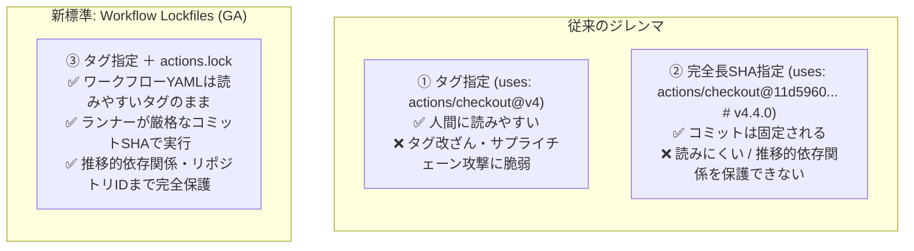

# GitHub Actionsの「Workflow Lockfiles」がGAされたので実際に動かして検証してみた
## 〜タグ指定の可読性を保ったままサプライチェーン攻撃を防ぐ新機能〜

2026年10月28日、GitHubは **GitHub Actionsのワークフロー依存関係ロックファイル（Workflow Dependency Lockfiles）** の一般提供（General Availability: GA）を発表しました。
（対象: GitHub Enterprise Cloud、データレジデンシー付きGEC、Team、Freeプラン）

本ドキュメントでは、この機能が解決するセキュリティ課題、ロックファイルの内部仕様、実際にローカルおよびCI環境で試した検証結果、および実践的な導入手順を解説します。

---

## 1. 背景と従来のジレンマ

GitHub Actions を利用する際、ワークフローファイル（`.github/workflows/*.yml`）内でアクションを呼び出す方法には、長年**「可読性」と「セキュリティ」の激しいトレードオフ**が存在していました。

### 従来の2つの方式と課題



1. **タグ / ブランチ参照 (`uses: actions/checkout@v4`)**:
   - **メリット**: 人間にとって直感的でバージョンが分かりやすい。
   - **リスク**: Gitのタグやブランチは **可変（Mutable）** です。サードパーティ製アクションのメンテナアカウントが乗っ取られたり、悪意あるリポイント（Tag Mutating / Repointing Attack）が行われると、ワークフロー定義を変更することなく悪意あるコードがCI上で実行されてしまいます。
2. **完全長コミットSHA直書き (`uses: actions/checkout@11d5960... # v4.4.0`)**:
   - **メリット**: コミットハッシュが固定されるため、タグ改ざんを防げる。
   - **重大な欠点**:
     - ワークフローファイルが極めて読みにくくなる。
     - **Composite Actionなどの推移的依存関係（Transitive dependencies: アクション内部で呼び出される別のアクション）を固定・保護できない**。
     - リポジトリ名が変更・乗っ取られた場合の偽装（Repo Takeover）を防げない。

---

## 2. Workflow Lockfile (`actions.lock`) の核心

Workflow Dependency Lockfiles は、npmの `package-lock.json` や Goの `go.sum`、Cargoの `Cargo.lock` と同様のロックファイル概念を GitHub Actions に導入したものです。

### 主な特徴

* **可読性と安全性の両立**: ワークフロー（`.github/workflows/*.yml`）側は `uses: actions/checkout@v4` のまま記述可能。実行時に GitHub Actions ランナーが `.github/workflows/actions.lock` を参照し、そこに記録された確定コミットSHAを実行します。
* **推移的依存関係（Transitive Dependencies）の完全カバー**: アクションが内部で呼び出している子アクション（Composite Actionの依存先）まで再帰的に解決・ピン留めします。
* **イミュータブルなリポジトリID保護**: コミットSHAだけでなく、GitHub内部の不変な数値ID（`owner_id`, `repo_id`）をロックファイルに記録。リポジトリ名が改名されたり乗っ取られたりした場合の偽装も実行時に弾きます。
* **Dependabot とのネイティブ連携**: Dependabot がアクションの更新PRを作成すると、追加設定なしで同一PR内で `actions.lock` も自動再生成・コミットされます。
* **Ref Narrowing（自動絞り込み）**: 初回ピン留め時、`@v4` のようなメジャーバージョン指定を、その時点で最新の完全なセマンティックバージョニングタグ（例: `v4.4.0`）に自動で絞り込み、以降の不用意なブレを抑止します。

---

## 3. ハンズオン検証（実際に動かしてみた）

本リポジトリ環境にて、最新の `gh-actions-lock` (v0.4.0) を用いて動作検証を実施しました。

### ① テスト用ワークフローの作成
`.github/workflows/ci.yml` を作成：

```yaml
name: CI Security Pipeline

on:
  push:
    branches: [main, master]
  pull_request:

permissions:
  contents: read

jobs:
  test:
    runs-on: ubuntu-latest
    steps:
      - name: Checkout repository
        uses: actions/checkout@v4

      - name: Set up Python
        uses: actions/setup-python@v5
        with:
          python-version: '3.11'

      - name: Run unit tests
        run: python -m unittest discover tests/
```

### ② ロックファイルの生成 (`gh actions-lock`)

```bash
gh actions-lock
```

**出力結果**:
```text
✓ Pinned 2 actions across 1 workflow
    actions/checkout@v4.4.0 (11d5960)
      └─ .github/workflows/ci.yml
    actions/setup-python@v5.6.0 (a26af69)
      └─ .github/workflows/ci.yml
```

ワークフロー側（`ci.yml`）には変更を一切加えず、`.github/workflows/actions.lock` が自動生成されました：

```yaml
# This file is machine-generated by `gh actions-lock`.
# Do not edit by hand; run `gh actions-lock` to update.
# Docs: https://gh.io/actions-lockfile
version: 'v0.0.3'
workflows:
    '.github/workflows/ci.yml':
        - 'actions/checkout@v4.4.0'
        - 'actions/setup-python@v5.6.0'
dependencies:
    'actions/checkout@v4.4.0':
        ref: 'v4.4.0'
        commit: 'sha1-11d5960a326750d5838078e36cf38b85af677262'
        owner_id: 44036562
        repo_id: 197814629
    'actions/setup-python@v5.6.0':
        ref: 'v5.6.0'
        commit: 'sha1-a26af69be951a213d495a4c3e4e4022e16d87065'
        owner_id: 44036562
        repo_id: 192625525
```

> [!NOTE]
> `actions/checkout@v4` と記述したものが、ロックファイル内では `actions/checkout@v4.4.0` および厳密なコミットハッシュ `sha1-11d5960...` に解決されています。

---

### ③ オフラインカバレッジ検証 (`--verify-local`)
通信を行わず、ワークフロー内のすべてのアクションがロックファイルに含まれているか（Coverage）を検証できます。pre-commit フックに最適です。

```bash
gh actions-lock --verify-local
```
**出力**:
```text
✓ All 1 workflow have complete lockfile coverage.
```

---

### ④ 未登録アクション混入時の遮断検証
`ci.yml` にロック未登録のアクション（`uses: actions/cache@v4`）を追加して `--verify-local` を実行すると：

```bash
gh actions-lock --verify-local
```
**出力**:
```text
✗ 1 of 1 workflow failed: 1 not-pinned

  Run without --verify-local to resolve and pin missing actions.
```
未追跡のアクションが追加されたことを即座に検知し、終了コード `1` でエラーとなりました。

---

### ⑤ 増分更新（Incremental Onboarding）の実証
`gh actions-lock` を再実行すると、未登録のアクションのみが増分追加されます：

```text
✓ Pinned 1 action across 1 workflow
    actions/cache@v4.3.0 (0057852)
      └─ .github/workflows/ci.yml
```

---

## 4. CI自動検証パイプラインの導入

PR作成時やmainブランチプッシュ時に、ロックファイルが最新かつ改ざんされていないかを自動検証するワークフローを導入します。

`.github/workflows/verify-lockfile.yml`:
```yaml
name: verify-lockfile

on:
  pull_request:
  push:
    branches:
      - main
      - master

permissions:
  contents: read

jobs:
  verify:
    runs-on: ubuntu-latest
    env:
      GH_TOKEN: ${{ github.token }}
    steps:
      - name: Checkout repository
        uses: actions/checkout@v4
        with:
          persist-credentials: false

      - name: Install gh-actions-lock extension
        run: gh extension install github/gh-actions-lock

      - name: Verify lockfile integrity
        run: gh actions-lock --verify
```

この検証ワークフロー自体も `gh actions-lock` でロックファイルに記録しておくことで、検証自体のサプライチェーン攻撃も防ぎます。

---

## 5. コマンドリファレンス & 運用モード

| コマンド | ファイル変更 | 外部通信 | 用途・シチュエーション |
|---|---|---|---|
| `gh actions-lock` | **あり** | あり | 初回オンボーディング、アクション追加時のロックファイル更新 |
| `gh actions-lock --verify` | なし | あり | **CIパイプライン**: ロック内容が上流のコミットと一致し有効か検証 |
| `gh actions-lock --verify-local` | なし | **なし** | **Pre-commit / オフライン**: 全アクションがロック済みかを高速検証 |
| `gh actions-lock --relock` | **あり** | あり | 動いたタグ（`v4` 等）を最新の上流コミットへ明示的に進める |
| `gh actions-lock --no-fix --json` | なし | あり | JSON形式での監査レポート出力・SOAR連携 |

### JSON出力例（監査・ポリシーチェック用）

```json
{
  "cli_version": "v0.4.0",
  "findings": [],
  "lockfile_version": "v0.0.3",
  "valid": true,
  "workflows": [
    {
      "path": ".github/workflows/ci.yml",
      "valid": true,
      "findings": [],
      "dependencies": [
        {
          "nwo": "actions/checkout",
          "ref": "v4.4.0",
          "sha": "11d5960a326750d5838078e36cf38b85af677262",
          "direct": true
        }
      ]
    }
  ]
}
```

---

## 6. 注意点と制限事項（Limitations）

1. **Reusable Workflows（再利用可能ワークフロー）の呼び出し**:
   - `jobs.<job_id>.uses` で呼び出される外部リポジトリの再利用可能ワークフローは、呼び出し側リポジトリのロックファイルではピン留めされません。
   - 再利用可能ワークフロー自体はコミットSHAで指定するか、呼び出し先リポジトリ側で自身の `actions.lock` を運用する必要があります。
2. **ローカルアクション（`./.github/actions/...`）**:
   - 同一リポジトリ内のローカルアクションがリモートアクションを呼んでいる場合、`--migrate-local-actions`（`$/...` 記法への変換）または `--ignore-local-actions` の指定が必要です。
3. **コンテナイメージ**:
   - ジョブで指定する Docker コンテナイメージ（`container: image:tag`）は本ロックファイルの保護対象外です。コンテナは `@sha256:...` ダイジェストによるピン留めを併用してください。

---

## 7. まとめ

GitHub Actions Workflow Lockfiles の GA により、**「ワークフローの可読性を保ったまま、厳格なサプライチェーンセキュリティと推移的依存関係の固定を実現する」** ことがデファクトスタンダードとなりました。

* 開発者はこれまで通り `uses: actions/checkout@v4` と直感的に書ける。
* セキュリティ担当者・CIは `.github/workflows/actions.lock` によって決定論的・不変なコミットSHA実行を担保できる。
* Dependabot や `gh actions-lock --verify` と連携することで、運用コストを最小化できる。

今後 GitHub Actions ワークフローを新規構築またはメンテナンスする際は、本機能を標準で導入することを強く推奨します。
