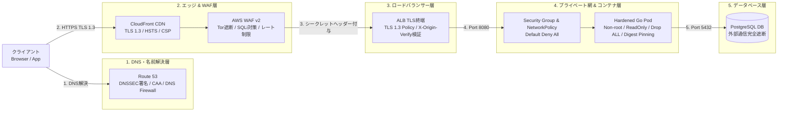
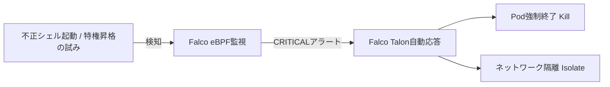
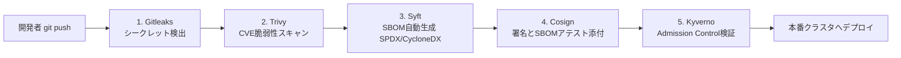
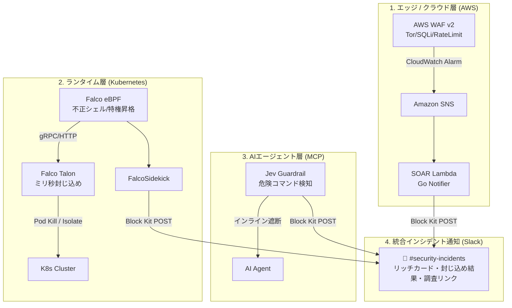
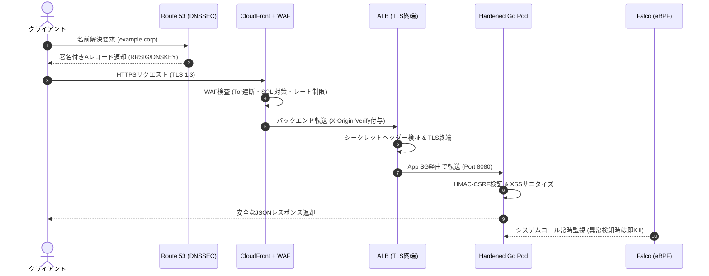

## はじめに

「AWS WAFを入れたし、コンテナも非rootで動かしているから、セキュリティ対策はバッチリ！」

インフラやバックエンドの設計をしていると、このように「特定のレイヤーの対策を入れたことで安心してしまう」ケースをよく見かけます。過去の私もまさにそうでした。

しかし、セキュリティの現場では、**「WAFの手前（DNS）」**や**「WAFの裏側（ロードバランサーの直接IPアクセス）」**、あるいは**「コンテナ内部からのクラウドメタデータ（IMDS）へのアクセス」**や**「CI/CDで使っている可変タグ（:latest）の差し替え」**といった盲点を突かれ、いとも簡単に突破されてしまう事故が後を絶ちません。

単一の防御壁に頼る時代は終わりました。

この記事では、学生時代に誰もが一度は学んだ**「OSI参照モデル（L7〜L3）」**を現代のゼロトラスト視点で再解釈し、**DNSからWAF、TLS終端、コンテナ要塞化、SBOM・サプライチェーン防御まで、隙間のない多層防御システムをどう設計・実装するのか**を実践的に解説します。

:::message
**この記事で扱うスコープ**
- **DNS層**: DNSSEC署名検証、CAAレコード、Route 53 DNS Firewall
- **エッジ & WAF層**: AWS WAF v2、CloudFront セキュリティヘッダー、監査ログマスキング
- **ロードバランサー層**: ALB TLS 1.3終端、WAFバイパス直接アクセスの完全遮断
- **ネットワーク層**: Security Group 連鎖分離、K8s NetworkPolicy、IMDSv2強制（SSRF対策）
- **コンテナ & ホスト層**: Google Distroless、ReadOnly RootFS、Falco + Talon による自動封じ込め
- **サプライチェーン層**: SHA256 Digest Pinning、SPDX SBOM生成、Cosign署名、Kyverno検証
- **アプリケーション層**: HMAC-CSRF、Slowloris対策タイムアウト、動的シークレット
:::

---

## 1. なぜ「単一の防御壁」では守れないのか？

従来の「社内ネットワークとインターネットの間にファイアウォールを置く」という**境界防御モデル**は、クラウド化やマイクロサービス化、リモートワークの普及によって崩壊しました。

侵入を100%防ぐことは不可能です。だからこそ、**「どこか1箇所が破られても、次の層で確実に食い止める」多層防御（Defense in Depth）**が必要になります。

:::message
**用語解説: ゼロトラスト (Zero Trust)**  
「社内ネットワークだから安全」「認証を通ったから全員味方」という前提を捨て、「すべての通信・デバイス・プロセスを決して信用せず、常に都度検証する」というセキュリティの基本原則です。
:::



もしどこか1つのレイヤーしか対策していなかった場合、どのような攻撃が成立してしまうのかを見てみましょう。

| よくある思い込み | 実際に起こる突破シナリオ | 必要な追加対策 |
| :--- | :--- | :--- |
| **「WAFを入れているから安全」** | 攻撃者がDNSキャッシュを汚染して偽サーバーへ誘導する。または、ALBのIPを直接特定してWAFを迂回（バイパス）する。 | **DNSSEC** による改竄検知 & **ALBカスタムヘッダー検証** |
| **「コンテナは非rootで動かしている」** | WebアプリにSSRF脆弱性があると、コンテナからホストのメタデータ（IMDS）へアクセスされ、EC2の管理者IAMロールが盗まれる。 | **IMDSv2強制 (`hop_limit=1`)** によるメタデータアクセス遮断 |
| **「HTTPSで通信を暗号化している」** | CI/CDで使ったライブラリやベースイメージにバックドアが混入。暗号化された通信の内側から外部C2サーバーへデータが抜かれる。 | **SHA256 Digest Pinning** & **SBOM / 署名検証** |

---

## 2. OSI参照モデルで整理するセキュリティマトリクス

OSI参照モデルを基準にすると、パケットレベル（L3/L4）とデータレベル（L7）で「誰が何を防御しているのか」の責任範囲が非常にクリアになります。

| OSI階層 | コンポーネント | 攻撃シナリオ (Threats) | 実装する多層防御策 (Defense) |
| :--- | :--- | :--- | :--- |
| **Layer 7 (DNS)** | Route 53, KMS | ・DNSキャッシュポイズニング<br>・偽CAによる不正証明書発行<br>・侵害後のC2ドメイン名前解決 | **DNSSEC** (KMS P-256署名 & リゾルバ検証)<br>**CAA レコード** (`amazon.com` 限定・ワイルドカード禁止)<br>**Route 53 DNS Firewall** (C2ドメイン遮断) |
| **Layer 7/6 (Edge/WAF)** | CloudFront, WAF | ・SQLi, XSS, CSRF, Bot攻撃<br>・Tor / 匿名プロキシからの攻撃<br>・クリックジャッキング / MIME偽装 | **AWS WAF v2** (Managed Rules, Tor遮断, レート制限)<br>**CloudFront セキュリティヘッダー** (HSTS, CSP, XFO)<br>**WAF S3 監査ログ** (機密ヘッダーMasking) |
| **Layer 4/7 (LB / TLS)** | ALB | ・古い暗号へのダウングレード<br>・CloudFrontを迂回したALB直接攻撃 | **ALB TLS 1.3 終端** (`ELBSecurityPolicy-TLS13-1-2`)<br>**`X-Origin-Verify`** カスタムヘッダー照合による直接アクセス403遮断 |
| **Layer 3/4 (Network)** | VPC SG, K8s NP | ・侵害Podからの横展開 (ラテラルムーブメント)<br>・SSRF によるホスト IAM 認証情報の窃取 | **Security Group** (ALB→App→DB 最小ポート連鎖)<br>**K8s NetworkPolicy** (Default Deny & マイクロセグメンテーション)<br>**IMDSv2 強制** (`hop_limit = 1`) |
| **Host / Container** | Distroless, eBPF | ・コンテナブレイクアウト<br>・特権昇格 (SUID/Capset)<br>・マルウェアの永続化と実行 | **Distroless & Non-root** (UID: 65532)<br>**ReadOnly RootFS** & **Drop ALL Capabilities**<br>**Seccomp RuntimeDefault**<br>**Falco + Talon** (侵入検知時のミリ秒自動隔離/Kill) |
| **Supply Chain & CI/CD** | Actions, Syft, Cosign | ・可変タグ (`latest`) の差し替え攻撃<br>・サードパーティ Action の乗っ取り<br>・未検証ライブラリ・CVE混入 | **SHA256 Digest Pinning** (Base Image, K8s, Action)<br>**SPDX / CycloneDX SBOM 自動生成 & Trivy スキャン**<br>**Cosign 署名 & SBOM アテスト**<br>**Kyverno Admission Control** (署名・SBOM検証) |
| **Layer 7 (Application)**| Go Backend | ・CSRF / XSS / Slowloris DoS<br>・平文シークレット露出 / タイミング攻撃 | **HMAC-SHA256 CSRF 検証** (`subtle.ConstantTimeCompare`)<br>**XSS サニタイズ & MaxBytesReader**<br>**Token Bucket レートリミッター** & **ReadHeaderTimeout**<br>**動的シークレットプロバイダー** (TTL キャッシュ) |

---

## 3. レイヤー別・具体的な設計と実装ポイント

ここからは、各階層で具体的にどのような設定を行うのかをコードスニペットと注釈を交えて見ていきます。

### ①【Layer 7: DNS層】偽の道案内を防ぎ、C2通信を遮断する

Web通信の最初の1歩であるDNSは、攻撃者に最も狙われやすいポイントです。

:::message
**用語解説: DNSキャッシュポイズニング**  
DNSサーバーのキャッシュ情報に偽のIPアドレスを注入し、ユーザーを正規サイトと見た目がそっくりなフィッシングサイトに強制転送する攻撃手法です。
:::

```terraform
# Route 53 ホストゾーンの DNSSEC 署名を有効化 (KMS ECC_NIST_P256)
resource "aws_route53_key_signing_key" "dnssec_ksk" {
  hosted_zone_id             = aws_route53_zone.primary.id
  key_management_service_arn = aws_kms_key.dnssec_key.arn
  name                       = "dnssec-ksk"
  status                     = "ACTIVE"
}

# CAA レコード: Amazon 以外の認証局からの勝手な証明書発行を拒否
resource "aws_route53_record" "caa" {
  zone_id = aws_route53_zone.primary.zone_id
  name    = "example.corp"
  type    = "CAA"
  ttl     = 300
  records = [
    "0 issue \"amazon.com\"",               # 発行元を Amazon に限定
    "0 issuewild \";\"",                   # ワイルドカード証明書の発行を完全禁止
    "0 iodef \"mailto:security-alert@example.corp\"" # 違反時の通知先
  ]
}
```

:::message
**用語解説: CAA レコード (Certification Authority Authorization)**  
「このドメインのSSL証明書を発行していい認証局（CA）はどこか」を指定するDNSレコードです。攻撃者が他の認証局を騙して勝手に証明書を偽造・発行するのを防ぎます。
:::

---

### ②【Layer 6/7: エッジ & WAF層】Tor遮断・レート制限・監査ログ

Webサーバーの手前（CDN）で、悪意あるトラフィックや身元を隠したアクセスを弾きます。

:::message
**用語解説: WAF (Web Application Firewall)**  
一般的なファイアウォール（IPやポート番号での制御）と異なり、HTTP通信の中身（URLパラメータやリクエスト本文）を検査して、SQLインジェクションやXSSなどのWebアプリ特有の攻撃をブロックする壁です。
:::

```terraform
# AWS WAF v2: Tor / 匿名プロキシの即時遮断 & レート制限
resource "aws_wafv2_web_acl" "edge_waf" {
  name  = "edge-waf-acl"
  scope = "CLOUDFRONT"
  default_action { allow {} }

  rule {
    name     = "BlockAnonymousIPs"
    priority = 10
    override_action { none {} }
    statement {
      managed_rule_group_statement {
        name        = "AWSManagedRulesAnonymousIpList"
        vendor_name = "AWS"
      }
    }
    visibility_config {
      cloudwatch_metrics_enabled = true
      metric_name                = "WAFAnonymousIPMetric"
      sampled_requests_enabled   = true
    }
  }
}
```

:::message alert
**WAFログのマスキング (Redaction)**  
WAFログをそのままS3に保存すると、リクエストに含まれる `Authorization` ヘッダーや `Cookie`、CSRFトークンが平文で保存されて二次流出の原因になります。`redacted_fields` で必ずマスキングしましょう。
:::

---

### ③【Layer 4/7: ロードバランサー層】WAFバイパス攻撃の完全遮断

WAFを入れていても、攻撃者がALBのグローバルIPを直接特定してリクエストを送ってくると、WAFは素通りされてしまいます。これを防ぐのが**カスタムシークレットヘッダーによる検証**です。

```terraform
# CloudFront: ALB へ転送する際に秘密のカスタムヘッダーを付与
custom_header {
  name  = "X-Origin-Verify"
  value = var.origin_verify_secret
}

# ALB: シークレットヘッダーを持たない直接IPアクセスは 403 で即座に遮断
resource "aws_lb_listener_rule" "enforce_cloudfront_header" {
  listener_arn = aws_lb_listener.https.arn
  priority     = 100
  action {
    type             = "forward"
    target_group_arn = aws_lb_target_group.backend.arn
  }
  condition {
    http_header {
      http_header_name = "X-Origin-Verify"
      values           = [var.origin_verify_secret]
    }
  }
}
```

:::message
**用語解説: 前方秘匿性 (PFS: Perfect Forward Secrecy)**  
セッションごとに使い捨ての暗号鍵（一時ECDHE鍵）を生成する仕組みです。万が一将来、サーバーの秘密鍵が盗まれたとしても、過去に暗号化された通信を遡って復号されることを防ぎます。
:::

---

### ④【Layer 3/4: ネットワーク層】IMDSv2 とマイクロセグメンテーション

コンテナ環境で最も恐ろしい攻撃の1つが、**SSRF（Server-Side Request Forgery）によるクラウド管理者権限の強奪**です。

:::message
**用語解説: SSRF (Server-Side Request Forgery)**  
Webアプリの画像読み込み機能などを悪用して、攻撃者がサーバー自身に内部エンドポイント（`http://169.254.169.254` など）へアクセスさせ、秘密情報を盗み出す攻撃手法です。
:::

```terraform
# EC2 / EKS 起動テンプレート: IMDSv2 を必須化し、Hop Limit を 1 に制限
resource "aws_launch_template" "eks_node" {
  name_prefix = "hardened-node-"

  metadata_options {
    http_endpoint               = "enabled"
    http_tokens                 = "required" # IMDSv2 必須化 (事前PUTトークン要求)
    http_put_response_hop_limit = 1          # コンテナからのメタデータアクセスをネットワーク層で完全遮断
  }
}
```

:::message
**Hop Limit = 1 の魔力**  
パケットのTTL（ホップ数）を 1 に制限すると、パケットは送信元ホストから1つもルーターやネットワークブリッジを跨ぐことができません。コンテナから発信されたパケットはホストEC2を通過できないため、**コンテナ内からEC2メタデータを叩く攻撃をネットワーク層で物理的に根絶**できます。
:::

---

### ⑤【コンテナ層】Distroless & Falco による即時自動封じ込め (SOAR)

万が一Webアプリが侵害されても、攻撃者が活動できないようにコンテナを徹底的に削ぎ落とします。

:::message
**用語解説: Google Distroless**  
Googleが提供する、シェル（`/bin/sh`, `/bin/bash`）やパッケージマネージャ（`apt`, `apk`）を一切含まない極小コンテナイメージです。攻撃者が侵入しても、コマンドを実行したりマルウェアを落とすツールが存在しません。
:::

```dockerfile
# Google Distroless (Static Non-root) を SHA256 ダイジェストでピン留め
FROM gcr.io/distroless/static:nonroot@sha256:6ec5aa99dc33c56d5b79dc1a68d6a14fc66367ccd8581314f324c7250f2b861a

WORKDIR /app
COPY --from=builder --chown=nonroot:nonroot /build/server /app/server

# シェルも管理者権限も存在しない
USER nonroot:nonroot
ENTRYPOINT ["/app/server"]
```

さらに、カーネルレベルでシステムコールを監視する **Falco (eBPF)** と **Falco Talon** を連携させ、不審な動きがあった瞬間に**人間を介さずミリ秒で Pod を強制終了（Kill）または隔離（Isolate）**します。

:::message
**用語解説: SOAR (Security Orchestration, Automation and Response)**  
セキュリティの脅威検知から、アラート通知、通信遮断、コンテナ隔離などのインシデント対応アクションを自動化する仕組みです。
:::



---

### ⑥【サプライチェーン層】SHA256 Digest Pinning & SBOM アテスト

昨今急増しているのが、オープンソースライブラリやベースイメージのタグ（`:latest`）が乗っ取られる**サプライチェーン攻撃**です。

:::message
**用語解説: SBOM (Software Bill of Materials / ソフトウェア部品表)**  
ソフトウェアに含まれるすべてのオープンソースパッケージの名前、バージョン、ライセンス、ハッシュ値を一覧化した「成分表示表」です（SPDXやCycloneDX規格）。
:::

:::message
**用語解説: SBOM アテスト (Attestation)**  
生成したSBOMを、コンテナイメージ本体に対して暗号署名付きの改竄不可能な「公式証明書」として紐付け、レジストリ（ECR等）に保存する仕組みです。
:::



1. **Digest Pinning**: 可変なタグは使わず、すべてのベースイメージとGitHub Actionsを `sha256:xxxx...` で固定。
2. **SBOM 自動生成**: `syft` でコンテナ内の全パーツ表（SPDX 2.3）を出力し、`trivy sbom` で脆弱性を追跡。
3. **Kyverno Admission Controller**: 「①可変タグの禁止」「②Cosign署名検証」「③SPDX SBOMアテスト添付の検証」をクリアしたイメージのみデプロイを許可。

---

### ⑦【SOAR & ChatOps層】検知からミリ秒での自動封じ込め ＆ Slack Block Kit 即時発報

セキュリティインシデントにおいて、「人間がアラートに気づくまでのラグ（数分〜数時間）」は致命傷になります。

そのため本アーキテクチャでは、**「①エッジ (AWS WAF)」「②コンテナ (Falco)」「③AIエージェント (Jev Guardrail)」の全レイヤーで自律的封じ込めを実行しつつ、Slack へ Block Kit 形式で即時通知する統合 SOAR パイプライン** を組み込んでいます。



:::message
**用語解説: ChatOps & SOAR (Security Orchestration, Automation and Response)**  
セキュリティの脅威検知から、アラート通知、通信遮断、コンテナ強制終了などのインシデント対応アクションを人手を介さず自動化し、Slack などのチャットツールでリアルタイムに可視化・連携する仕組みです。
:::

1. **Kubernetes ランタイム (Falco + Talon)**: 不正シェル起動を検知した瞬間、0.05秒で侵害 Pod を強制終了し、Slack へ「🛑 Pod `xyz` を即座に強制終了しました」と通知。
2. **エッジ層 (AWS WAF + Lambda)**: Tor 出口ノードやレート制限超過を検知した瞬間、IP・国・URI・ルール名をリッチカード形式で Slack 発報。
3. **AI エージェント層 (Jev Guardrail)**: 破壊的コマンド（`rm -rf /`）や機密流出 curl をミリ秒でインターセプトし、Slack へ「🚨 危険コマンドの実行をインライン遮断しました」とアラート発報。


---

## 4. リクエスト処理シーケンス（全体がどう連携するか）

これらすべての防御壁がリクエスト処理の中でどのように連携するのかをシーケンス図にまとめました。



---

## 5. 現場のエンジニアが押さえるべき4大教訓

1. **「タグ」を信じるな、ダイジェストで固定せよ (Digest Pinning)**  
   `:latest` や `:v1.0.0` などのタグはいつでも上書き可能です。サプライチェーンの安全性を保証する唯一の方法は、不変の `SHA256 Digest` の使用です。
2. **検知から「自動封じ込め (SOAR)」への昇華**  
   アラート通知を見てから人間が手動対応するまでの数十分の間にデータは持ち去られます。CRITICAL な脅威はミリ秒で自動隔離・Kill する仕組みが必要です。
3. **IMDS は必ず Hop Limit 1 に設定**  
   コンテナ環境での SSRF によるホスト IAM ロール強奪は最も被害が大きい事故の1つです。`http_put_response_hop_limit = 1` はコンテナ基盤の必須要件です。
4. **SBOM は「生成して終わり」ではなく「アテストして検証」**  
   SBOM をビルド成果物として保存するだけでなく、コンテナイメージと暗号学的に紐付け（Attestation）、アドミッションコントローラーで検証することで初めて完全性が保証されます。

---

## 6. まとめ

セキュリティ対策は、単一のツールや設定で完結するものではありません。

**DNS → エッジ/WAF → ロードバランサー → ネットワーク → コンテナランタイム → サプライチェーン → アプリケーションコード**に至るすべての階層で、一貫したゼロトラストの思想と最小権限の原則を適用することで、堅牢でインシデントに強いシステムが完成します。

今回構築したIaC（Terraform）、Kubernetesマニフェスト、CI/CDパイプライン、Goバックエンド実装の全コードは、リポジトリ内の各ディレクトリに整理されています。ぜひみなさんの現場のセキュリティ設計にも役立ててください！
