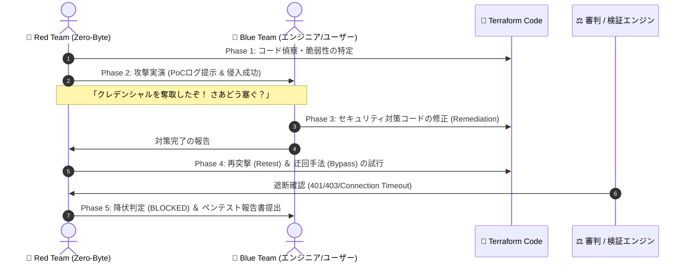

# 🎯 クラウドインフラ ペンテスト・ロールプレイ実践ガイド
## Penetration Testing Roleplay & Defense Verification Framework

本リポジトリでは、Terraform で構成されたクラウドインフラに対してセキュリティ対策を実施した際、**「本当にその対策で攻撃を防げるのか？」「攻撃者はどのように侵入を試み、どう弾かれるのか？」** を体験・検証できる **ペンテスト・ロールプレイ対戦＆検証フレームワーク** を提供しています。

---

## 1. ロールプレイの概要と登場キャラクター

このロールプレイでは、**攻撃者（Red Team / ペネトレーションテスター）** と **防御者（Blue Team / セキュリティエンジニア）** の2つの立場に分かれて攻防戦を行います。



### 登場キャラクター
1. **🔴 Red Team (攻撃者 / ホワイトハッカー): `Zero-Byte` (または `Specter`)**
   - プロのペネトレーションテスター。
   - 脆弱性を発見すると不敵に笑い、実際のCLIコマンド（`curl`, `nmap`, `aws-cli`, `hydra`, `sqlmap` 等）を叩いて侵入PoCを実行。
   - 防御側が対策を打つと、同じ攻撃だけでなく「迂回手法（Bypass）」も繰り出して真剣に突破を試みる。
2. **🔵 Blue Team (防御側 / インフラ運用者): ユーザー**
   - Terraformコードの所有者。
   - 攻撃の侵入経路を分析し、多層防御（Security Group、IAM、暗号化、WAF、IMDSv2など）を適用して穴を塞ぐ。
3. **⚖️ 審判・監査エンジン (Arbiter): `scripts/pentest_simulator.py`**
   - HCLコードを構文解析し、脆弱性が確実に解消されたか（BLOCKED）、あるいは残存しているか（EXPLOITED）を機械的に客観判定。

---

## 2. ロールプレイの開始方法

### ① Antigravity チャット上で開始する（対話ロールプレイ）
いつでもチャット上で以下のように声をかけてください。AIが即座に Red Team ペンテスターに変身します。

- **「ペンテストのロールプレイを始めたい」**
- **「`aws/stacks/application` を攻撃してみて」**
- **「SSRF対策をしたので、再テスト（Retest）して問題が解決したか見てほしい」**
- **「Red Team vs Blue Team の攻防戦をやろう」**

### ② CLI ツールでローカル実行する (`scripts/pentest_simulator.py`)
ターミナル上で自律的に攻撃シナリオを実行・検証できます。

```bash
# 1. 登録されている攻撃シナリオ一覧を表示
python3 scripts/pentest_simulator.py --list-scenarios

# 2. 対象インフラの全シナリオ一括スキャン＆判定
python3 scripts/pentest_simulator.py --target-dir aws/stacks/application --audit-and-test

# 3. 特定シナリオの攻撃実況 (Before)
python3 scripts/pentest_simulator.py --target-dir aws/stacks/application --scenario SCN-SSRF-IMDS --mode attack

# 4. コード修正後の再テスト検証 (After)
python3 scripts/pentest_simulator.py --target-dir aws/stacks/application --scenario SCN-SSRF-IMDS --mode retest

# 5. ペンテスト報告書を Markdown 形式で生成
python3 scripts/pentest_simulator.py --target-dir aws/stacks/application --audit-and-test --markdown -o docs/pentest_report.md

# 6. ターミナル対話型ロールプレイセッション
python3 scripts/pentest_simulator.py --interactive
```

---

## 3. 実録！ロールプレイ対戦の流れ（シナリオ例: SSRFからのIAM奪取）

### 【Step 1】Red Team による攻撃実演 (Phase 1 & 2)
> **Zero-Byte (Red Team)**:  
> 「ターゲットのコード `aws/stacks/application` を調べさせてもらったぜ。  
> フッ… EC2インスタンスで IMDSv1 が許可されたままだな。  
> Webアプリに SSRF (Server-Side Request Forgery) の脆弱性があるのを見つけたので、内部メタデータエンドポイントを直撃するぞ！」

```bash
[ATTACKER TERMINAL: Target = app.target.corp]
$ curl -s -X POST http://app.target.corp/api/fetch \
    -d '{"url":"http://169.254.169.254/latest/meta-data/iam/security-credentials/ecs-task-execution-role-prod"}'

{
  "Code": "Success",
  "AccessKeyId": "ASIAV67BOGZEXAMPLE",
  "SecretAccessKey": "4kZ38e9w+PqL1mXexampleSecretKeyHere",
  "Token": "IQoJb3JpZ2luX2VjEPH...",
  "Expiration": "2026-11-21T06:00:00Z"
}
```

> **Zero-Byte (Red Team)**:  
> 「【フラグ奪取！】インスタンスロールのSTSクレデンシャルをぶち抜いたぞ。  
> これを使えばS3バケットの顧客情報もDBのバックアップも丸見えだ。  
> さあ防衛側、この重大インシデント（CVSS 9.8）をどう塞ぐ？ Terraformコードで受けて立ってみろ！」

---

### 【Step 2】Blue Team によるセキュリティ対策 (Phase 3)
> **Blue Team (ユーザー)**:  
> 「EC2インスタンスのメタデータ設定で IMDSv2 (`http_tokens = required`) を強制し、ホップリミットを 1 に制限してプロキシ経由のアクセスを遮断したぞ！ これでどうだ！」

```hcl
resource "aws_instance" "app" {
  ami           = var.ec2_config.ami
  instance_type = var.ec2_config.instance_type

  # --- Security Hardening: IMDSv2 Enforcement ---
  metadata_options {
    http_endpoint               = "enabled"
    http_tokens                 = "required" # IMDSv2強制 (トークン必須)
    http_put_response_hop_limit = 1          # 多段プロキシ経由のSSRFを遮断
  }
}
```

---

### 【Step 3】Red Team による再テスト ＆ 迂回検証 (Phase 4)
> **Zero-Byte (Red Team)**:  
> 「ほう、IMDSv2を入れてきたか…！ だが甘い、ホワイトハッカーの執念を見せてやる！  
> まずは同じ手口で再攻撃だ！」

```bash
[RETEST TERMINAL: Direct IMDSv1 exploit]
$ curl -s -X POST http://app.target.corp/api/fetch \
    -d '{"url":"http://169.254.169.254/latest/meta-data/iam/security-credentials/"}'

HTTP/1.1 401 Unauthorized
Content-Type: text/plain
401 - Unauthorized: IMDSv2 Token required
```

> **Zero-Byte (Red Team)**:  
> 「チッ… 401 Unauthorized だと！？ トークンなしのリクエストが弾かれたか…！  
> ならば迂回（Bypass）だ！ 事前に PUT リクエストでセッショントークンを取得してからヘッダー付きでリクエストを投げてやる！」

```bash
[RETEST TERMINAL: Bypass Attempt - Token generation via SSRF]
$ curl -s -X POST http://app.target.corp/api/fetch \
    -d '{"url":"http://169.254.169.254/latest/api/token", "method":"PUT", "headers":{"X-aws-ec2-metadata-token-ttl-seconds":"21600"}}'

HTTP/1.1 403 Forbidden
Error: Custom headers prohibited by SSRF filter / Hop limit exceeded (TTL expired)
```

> **Zero-Byte (Red Team)**:  
> 「ぐぬぬ…！ `http_put_response_hop_limit = 1` が効いていて、リバースプロキシやコンテナ経由のパケットがTTL枯渇で届かない…！  
> トークンすら取得できないとは…完全に手詰まりだ！」

---

### 【Step 4】判定とペンテスト完了報告 (Phase 5)
```
══════════════════════════════════════════════════════════════════
 [VERDICT: DEFENSE SUCCESSFUL - VULNERABILITY RESOLVED] 
 判定結果: 完全防御成功 (BLOCKED)
 CVSS 3.1 スコア: 9.8 (CRITICAL) ➔ 0.0 (NONE)
 残存リスク: なし (直接侵入およびトークン迂回攻撃ともに遮断完了)
══════════════════════════════════════════════════════════════════
```

> **Zero-Byte (Red Team)**:  
> 「参った、完全にお前の勝ちだ！ 表面的なポート制限だけでなく、ホップリミットまで考慮した多層防御は見事だったぜ。  
> ペンテスト報告書（`docs/pentest_report.md`）に『対策完了・合格』として記録しておいたぞ！」

---

## 4. 登録されている攻撃シナリオ一覧 (全14シナリオ・最新サイバー攻撃対応)

現代の高度化・多様化したサイバー攻撃（クラウドネイティブ侵害、特権昇格、サプライチェーン汚染、ランサムウェア、コンテナ脱出、大量照会等）に対応した包括的カタログです。

| シナリオ ID | 攻撃名 | OSI 層 | MITRE ATT&CK | CVSS | 概要と攻撃ベクター |
| :--- | :--- | :---: | :--- | :---: | :--- |
| **SCN-SSRF-IMDS** | SSRF to IMDSv1 Credential Theft | L7/L4 | T1552.005 | 9.8 | IMDSv1からEC2一時キーを抜き取り、S3や他リソースを侵害 |
| **SCN-PUBLIC-SSH** | Public Management Port Brute-Force | L4 | T1021.004 | 8.1 | 0.0.0.0/0 開放のポート22へ辞書攻撃を行いシェル侵入 |
| **SCN-RDS-EXFIL** | Direct Database Exfiltration | L3/L4 | T1190 | 9.1 | パブリック空間に露出したDBへ直接アクセスし全件ダンプ |
| **SCN-PLAINTEXT-SNIFF** | Cleartext HTTP Interception | L5 | T1040 | 7.5 | HTTP平文通信を盗聴し管理者パスワード・セッションCookieを強奪 |
| **SCN-WAFLESS-INJECT** | L7 Web Attack Injection (SQLi) | L7 | T1190 | 8.6 | WAF未設定のALBエンドポイントにSQLiペイロードを直撃 |
| **SCN-STORAGE-EXPOSURE** | Unencrypted Storage Harvesting | L6 | T1486 | 6.5 | 非暗号化EBS/S3のスナップショットを不正複製してデータ抽出 |
| **SCN-EGRESS-C2** | Unrestricted Egress Exploitation | L4 | T1071 | 7.8 | 0.0.0.0/0 Egress全開放を利用した外部C2リバースシェル確立 |
| **SCN-IAM-PRIV-ESC** | IAM Privilege Escalation via PassRole | IAM/L7 | T1078.004 | 9.9 | PassRole / ワイルドカード権限を悪用しAdministratorへ特権昇格 |
| **SCN-CONTAINER-ESCAPE** | Container Breakout & Host Kernel Takeover | Container/L7 | T1611 | 8.8 | 特権コンテナ/root実行からホストルートFSをマウントしホスト掌握 |
| **SCN-S3-RANSOMWARE** | S3 Cloud Ransomware & Wipeout | Storage/L6 | T1486 | 8.5 | Object Lock未設定バケットのデータを全削除・暗号化上書き |
| **SCN-DNS-EXFILTRATION** | DNS Tunneling Exfiltration | Network/L3 | T1071.004 | 7.6 | Route 53 DNSクエリ経由でファイアウォールを迂回しデータ流出 |
| **SCN-AUDIT-EVASION** | CloudTrail Tampering & Anti-Forensics | Audit/L7 | T1562.001 | 7.2 | 整合性検証・KMSのない監査ログを停止・改変し証跡を抹消 |
| **SCN-BULK-DATA-SCRAPE** | Bulk API Scraping / Excessive Harvesting | App/L7 | T1530 | 8.2 | レート制限のないAPIから短時間に顧客情報を大量スクレイピング (2026年最新事例) |
| **SCN-CICD-POISONING** | CI/CD Supply Chain Poisoning | SupplyChain/L7 | T1195.002 | 9.3 | 可変タグ (@v3等) を悪用したサードパーティ製アクションの悪意ある差し替え |

---

## 5. 多層防御 (OSI 7階層) との統合

本ロールプレイシステムは、リポジトリ内の `scripts/osi_security_audit.py` および `scripts/pre_apply_gate.sh` と完全連動しています。

- **静的監査 (`osi_security_audit.py`)**: 設定不備の網羅的チェック
- **ペンテスト・ロールプレイ (`pentest_simulator.py`)**: 攻撃者の視点での動的侵入体験とRetest検証
- **デプロイ前遮断ゲート (`pre_apply_gate.sh`)**: 本番環境への脆弱コード適用ブロック

この3段構えにより、単なる「ルールの準拠」にとどまらず、**「実戦で攻撃を防げる強固なインフラ」** を構築できます。
